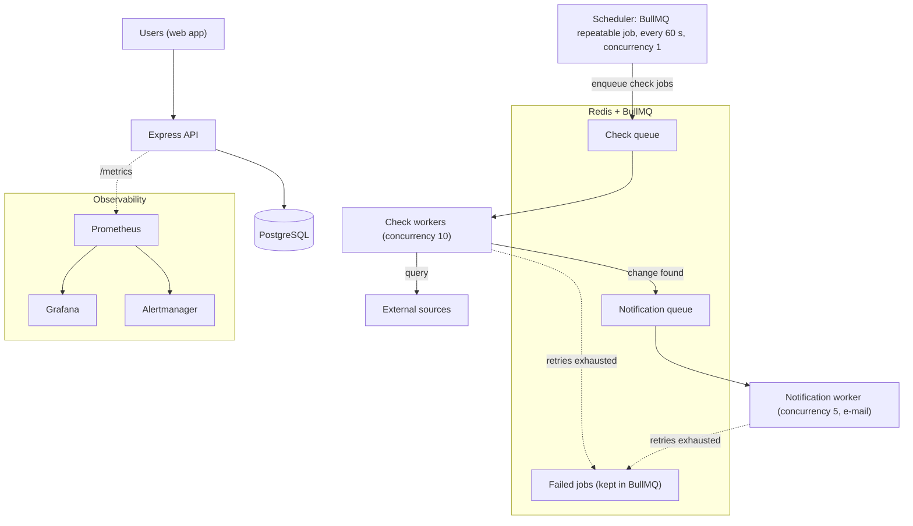

# Case Study: Queue-Based Background Processing for a Monitoring Platform

### Moving periodic checks of slow external sources out of a sequential polling script into BullMQ workers, with retries, failure isolation and Prometheus-based observability

---

> **About this project**
> This is paid, client-owned freelance work, and it is still under active development. The proprietary source code is not published. This repository explains the architecture and the engineering decisions; it contains no source code and no client information.

---

## 1. Project overview

The platform lets users register what they want to watch for. It checks several external sources on a schedule and notifies users when something they are waiting for becomes available.

External sources are slow and unreliable, and they limit how often they can be queried. Checks therefore have to run continuously in the background, independently of the web application that users interact with.

---

## 2. The starting point

The first version was a single Node.js polling script. It read its targets from a local SQLite database through a synchronous driver, then checked them **one after another**, waiting a fixed second between requests.

```
+------------------------------+
|   Polling script (1 process) |
|  for each target:            |
|    query SQLite (sync)       | ---- one request at a time ----> [ External sources ]
|    await fetch(...)          |
|    wait 1 s                  |
+------------------------------+
```

### Why this did not scale

1. **Sequential checks.** Node.js does not block a thread while it waits for a network response, but the script awaited each check before starting the next. The total time per cycle grew linearly with the number of targets, and one slow source delayed all the others.
2. **Synchronous database access.** The synchronous SQLite driver blocks the Node.js event loop for the duration of every query, so nothing else in the process can run during that time.
3. **No failure handling.** A failed request was not retried in a controlled way, and the only rate control was the fixed one-second pause.
4. **No visibility.** There were no metrics on backlog, failures or how long checks took.

---

## 3. The redesigned architecture (implemented)

The checks now run as jobs in Redis-backed BullMQ queues, processed by separate worker processes.



### What is implemented

* **Scheduling as a repeatable job.** A BullMQ repeatable job replaces the old polling loop. It runs every 60 seconds with concurrency 1, so only one scheduling run happens at a time even when several instances are running.
* **Separate queues.** Checks and outgoing notifications use separate queues, so slow notification delivery cannot hold up checks, and the other way round.
* **Worker processes.** Check workers process up to 10 jobs at a time, notification workers up to 5. The API, the workers and the database run as separate Docker Compose services.
* **Retries with exponential backoff.** Jobs are retried with BullMQ's exponential backoff: check jobs up to 3 attempts with a 5-second base delay, notification jobs up to 5 attempts with a 10-second base delay.
* **Failure isolation.** A job that fails is retried on its own and does not stop other jobs. When a job has used up all retries, it stays in BullMQ's failed set and is logged as a dead letter that needs manual attention.
* **API protection.** The public API has request rate limiting.
* **Observability.** The API exposes Prometheus metrics for queue depth by state (waiting, active, failed), notification status and database connection-pool usage, plus Node.js runtime metrics. Prometheus, Alertmanager and Grafana run as a separate Compose stack.

---

## 4. Tech stack

* **Runtime:** Node.js (JavaScript) for the API and workers; Next.js with TypeScript for the web frontend; Python for a separate helper service.
* **Queueing:** Redis and BullMQ.
* **Database:** PostgreSQL.
* **Infrastructure:** Docker and Docker Compose; GitHub Actions for CI.
* **Observability:** prom-client, Prometheus, Alertmanager and Grafana.
* **Testing:** Jest, plus load, soak and chaos-test scripts.

---

## 5. Retry behaviour

BullMQ's exponential backoff doubles the waiting time after each failed attempt:

$$\text{delay}_n = \text{base delay} \times 2^{n-1}$$

Check jobs use a 5-second base delay, so a failing check is retried after about 5 and then 10 seconds before it is marked as failed. Notification jobs use a 10-second base delay and up to five attempts. This keeps temporary outages at a source from turning into a flood of immediate retries.

---

## 6. Observability and alerting (implemented)

```
+---------------------+        +------------+        +-----------+
| API /metrics        | -----> | Prometheus | -----> | Grafana   |
| (queue depth, pool, |        |            | -----> | Alert-    |
|  runtime metrics)   |        +------------+        | manager   |
+---------------------+                              +-----------+
```

Alert rules defined in the Prometheus configuration:

* `HighQueueBacklog`: too many jobs waiting in a queue.
* `HighEventLoopLag`: the Node.js event loop is delayed, an early sign of blocking work.
* `RedisReconnectStorm`: repeated reconnects to Redis.
* `MemoryLeakWarning`: memory use keeps growing.

---

## 7. Possible next steps (designed, not implemented)

These ideas follow from the design but are **not** part of the current implementation:

* **Jitter on retries,** so that many jobs failing at the same moment do not all retry at the same moment.
* **Per-source rate limiting in the workers** (for example with BullMQ's limiter), and pausing work for a source after it returns HTTP 429.
* **A dedicated dead-letter queue** with external alerting, instead of the failed set and log entries.
* **Job-latency and per-source error-rate metrics,** in addition to queue depth.

---

## 8. Key engineering takeaways

1. **Move slow external work out of the main process loop.** Queues and workers let checks run in parallel and keep one slow source from delaying the rest.
2. **Avoid synchronous I/O in Node.js services.** Synchronous drivers block the event loop. An event-loop lag alert makes this kind of problem visible.
3. **Retries need limits and spacing.** Exponential backoff and a maximum number of attempts keep retries from making an outage worse.
4. **Measure the queues.** Queue-depth metrics and backlog alerts show capacity problems before users notice them.
